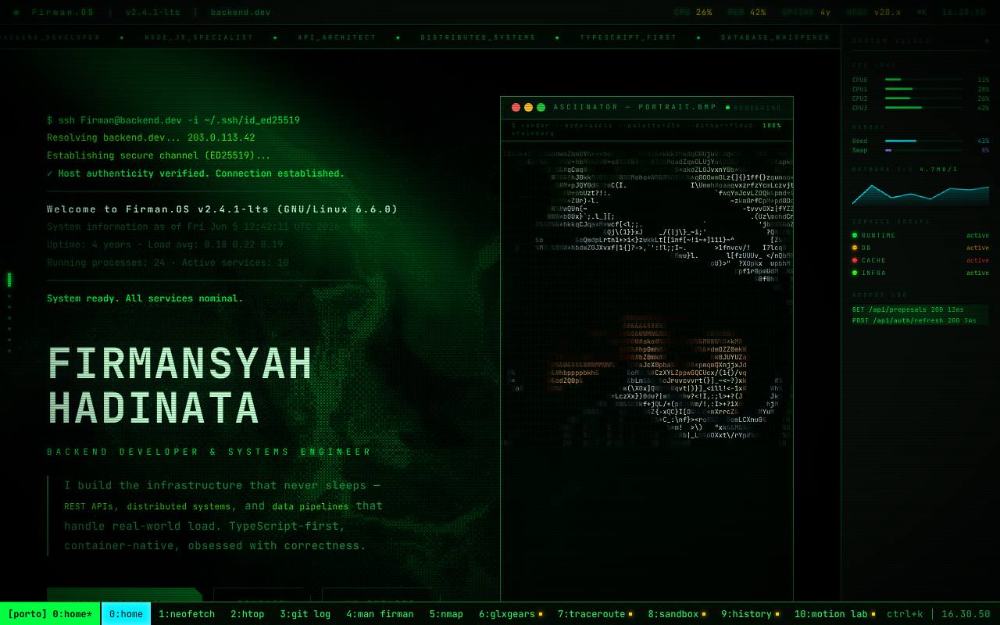
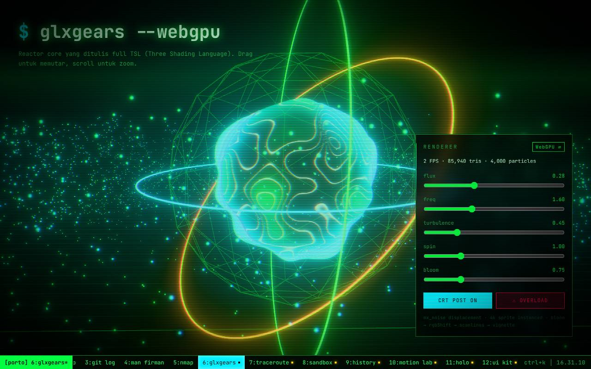
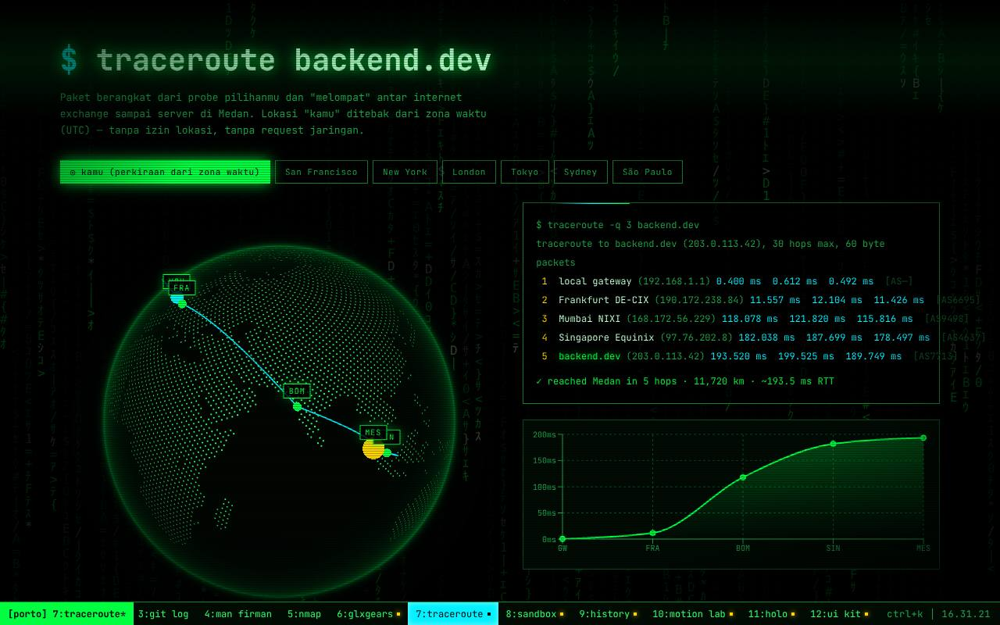
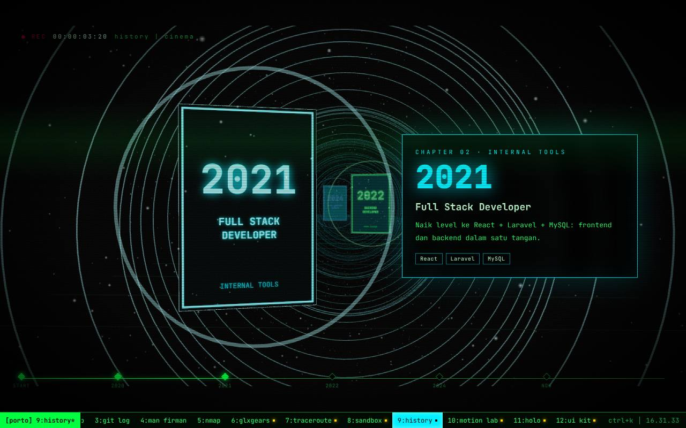
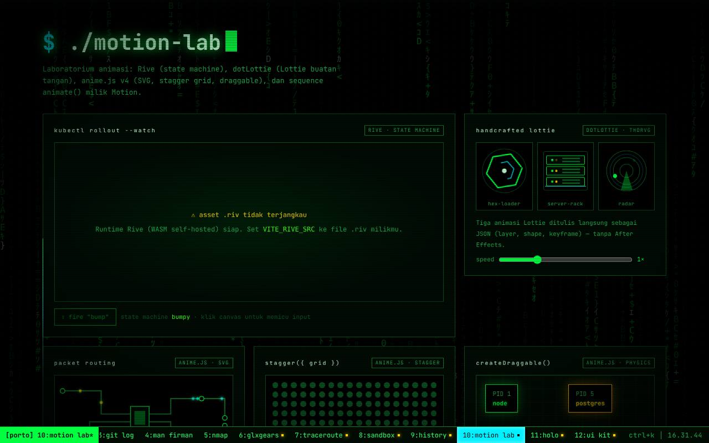
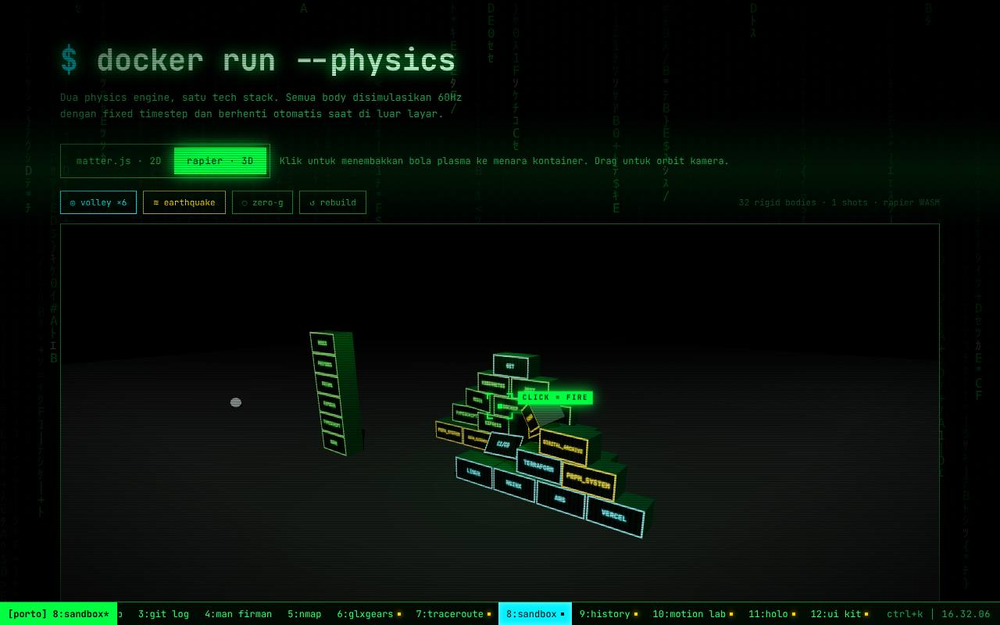
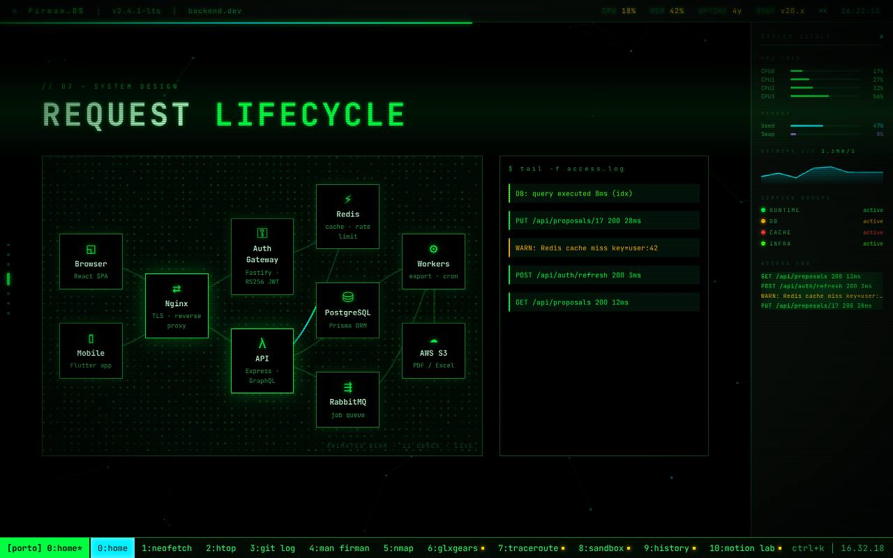

# Firman.OS — portofolio Firmansyah Hadinata

Portofolio interaktif bergaya terminal fosfor: setiap halaman adalah "window tmux", setiap
transisi adalah glitch CRT, dan setiap efek ditulis dengan library animasi modern —
WebGPU, physics engine, globe, sinema yang digerakkan scroll, hingga Lottie yang ditulis tangan.



| | |
|---|---|
|  `/glxgears` — Three.js WebGPU + TSL |  `/traceroute` — cobe globe |
|  `/history` — Theatre.js cinema |  `/lab` — Rive · dotLottie · anime.js |
|  `/sandbox` — Rapier + Matter.js |  home — AnimatedBeam |

## Menjalankan

```bash
npm install
```

```bash
npm run dev
```

```bash
npm run build
```

```bash
npm run preview
```

`npm run check` = lint + build sekaligus (dipakai sebelum commit).

## Halaman

| Route | Isi | Library utama |
|---|---|---|
| `/` | Intro polyglot (38 bahasa), hero shader, boot log, potret ASCII, about, tech stack, diagram arsitektur, docker ps, graf d3, terminal, globe kontak | OGL, anime.js (splitText, scrambleText), Motion (parallax, layoutId), GSAP ScrollTrigger + ScrambleText, tsParticles, d3-force, cobe |
| `/neofetch` | Info sistem — GPU, browser, core, resolusi dibaca dari perangkat pengunjung | Motion, Magic UI |
| `/htop` | Monitor service live, sparkline, sort dengan animasi layout, F6/F9 | Motion `layout`, tsParticles confetti |
| `/git-log` | Timeline proyek dengan beam yang tumbuh mengikuti scroll | Motion `useScroll` + `useTransform` |
| `/man` | Manual page dengan tracing beam | Aceternity TracingBeam, TextGenerate |
| `/scan` | nmap + radar sweep | anime.js stagger |
| `/glxgears` | Reactor core: noise MaterialX, 4.000 partikel instanced, bloom → RGB shift → scanline (WebGPU, fallback WebGL2) | Three.js r187 `three/webgpu` + TSL |
| `/traceroute` | Rute paket hop-by-hop dari lokasi pengunjung (tebakan zona waktu) ke Medan, arc di globe, grafik latency | cobe v2, recharts |
| `/sandbox` | Chip tech stack yang bisa dilempar (2D) dan menara kontainer yang bisa ditembak (3D) | Matter.js, Rapier (WASM) + Three.js |
| `/history` | Sinema karier yang dikendalikan scroll: kamera, kabut, kartu chapter | Theatre.js + Three.js |
| `/lab` | Rive state machine, Lottie buatan tangan, sirkuit SVG, stagger grid, draggable, pipeline | Rive, dotLottie, anime.js v4, Motion `animate()` |
| `/holo` | Scene Spline, scene Unicorn Studio (fallback shader dithering), kartu identitas holografik | Spline, Unicorn Studio, Aceternity 3D Card, tsParticles |
| `/ui` | Galeri 24 komponen Magic UI × Aceternity (live) + dock magnifikasi | Tailwind v4, Motion |
| `/*` lainnya | 404 sebagai *kernel panic* dengan auto-reboot | Motion `animate()`, OGL |

## Fitur global

- **Router hash + View Transitions API**: chunk halaman di-preload dulu sehingga snapshot transisi selalu berisi konten final. Klik mouse memberi reveal lingkaran dari titik klik, keyboard memberi glitch slice, tombol back memberi wipe. Judul halaman "morph" antar route. Posisi scroll diingat untuk back/forward. Browser tanpa VT mendapat fallback fade Motion.
- **Lenis smooth scroll**, disinkronkan ke GSAP ScrollTrigger lewat event scroll. Scroll di area bersarang (terminal, palette, kode) tidak ditelan.
- **Command palette** `Ctrl/⌘+K`: fuzzy search halaman dan aksi (confetti, fireworks, toggle CRT/matrix/cursor), highlight shared-layout.
- **Tombol tmux asli**: `Ctrl+B` lalu `n` / `p` / `0-9`.
- **Kursor reticle** yang mengunci ke elemen interaktif, label dari `data-cursor`, dan berubah jadi I-beam di input. Hanya aktif untuk mouse presisi.
- **Overlay CRT** (scanline, vignette, flicker, roll bar) dan hujan matrix. Keduanya bisa dimatikan dari palette dan disimpan per-browser.
- **Easter egg**: Konami code (↑↑↓↓←→←→BA) memunculkan kembang api, dan di terminal home `sudo rm -rf /` memicu kernel panic.
- **Terminal home**: `help`, `pages`, `cd <halaman>`, `confetti`, `fireworks`, `matrix`, `palette`, `history`, dan lainnya, dengan Tab completion dan riwayat ↑/↓.

## Performa

- Setiap halaman di-split jadi chunk sendiri. Library berat hanya diunduh saat halamannya dibuka: three/webgpu ±880 KB, Rapier ±4 MB (WASM inline), Spline ±2 MB, Rive/dotLottie WASM.
- Initial load sekitar **137 KB gzip** (React, Motion, Lenis, shell). Halaman home secara total sekitar **195 KB gzip**. GSAP, tsParticles, d3, dan globe dimuat menyusul secara lazy atau saat idle.
- WASM Rive dan dotLottie di-host sendiri sebagai aset hash Vite, tanpa ketergantungan ke unpkg/jsdelivr saat runtime.
- Semua loop rAF/WebGL berhenti saat elemennya di luar layar atau tab tersembunyi. Shader dirender di resolusi rendah, dan DPR dibatasi.
- Chunk halaman "core" di-prefetch saat browser idle. Halaman lain di-prefetch saat link-nya di-hover.
- `prefers-reduced-motion` dihormati di semua tempat: Lenis, View Transitions, shader, partikel, sinema, dan kursor.

## Konfigurasi (opsional)

Salin `.env.example` ke `.env.local`:

| Variabel | Fungsi |
|---|---|
| `VITE_SPLINE_SCENE` | URL `.splinecode` untuk `/holo`. Default: scene demo resmi Spline. |
| `VITE_UNICORN_PROJECT_ID` | Project ID Unicorn Studio. Jika kosong, dipakai shader dithering OGL. |
| `VITE_RIVE_SRC`, `VITE_RIVE_STATE_MACHINE`, `VITE_RIVE_INPUT` | File `.riv` untuk `/lab`. Default: contoh resmi `vehicles.riv`. |

## Mengubah konten

Semua data ada di **`src/data/profile.js`**: profil, kontak, skill, proyek, riwayat kerja, graf, dan log.
Ubah file itu, maka home, htop, git-log, man, traceroute, history, terminal, dan holo ikut berubah.

> ⚠️ Kontak (email, GitHub, LinkedIn, Telegram) masih memakai nilai dari versi lama situs.
> Ganti dengan akun asli sebelum dipublikasikan.

Timeline sinema `/history` bisa diedit secara visual dengan **Theatre Studio**. Jalankan
`npm run dev`, buka `/#/history?studio`, atur keyframe, lalu salin state hasil export ke `src/pages/history/script.js`.

## Struktur

```
src/
  app/          router (View Transitions), tabel route, shell, error boundary
  components/
    fx/         shader OGL, globe cobe, CRT, kursor, matrix rain, scramble
    shell/      command palette, tmux bar, smooth scroll
    ui/         kit Magic UI × Aceternity (Tailwind v4)
  data/         konten (profile, terminal, greetings, network)
  lib/          utilitas (scroll, media query, geo, gsap, particles, fuzzy, layout)
  pages/        satu folder per halaman (lazy-loaded)
  styles/       base (token + Tailwind), theme, shell, mobile
archive/        salinan App.jsx lama (tidak di-build)
```

## Catatan teknis

- recharts meng-import `es-toolkit/compat/*` yang hanya tersedia dalam CJS, dan rolldown 1.0.x salah me-rename wrapper-nya. Plugin kecil di `vite.config.js` mengalihkannya ke build ESM `es-toolkit/compat`.
- tsParticles v4 hanya menerima registrasi plugin sebelum `load()` pertama. Semua plugin (slim, confetti, fireworks) didaftarkan sekali oleh `ensureEngine()` di `src/lib/particles.js`.
- Pengukuran layout (AnimatedBeam, shader, canvas) memakai `offsetLeft`/`clientWidth`, bukan `getBoundingClientRect`, supaya tidak terdistorsi transform seperti animasi CRT power-on.
- Routing berbasis hash (`#/htop`), sehingga bisa di-deploy ke static hosting apa pun (Vercel, Netlify, GitHub Pages) tanpa aturan rewrite.
# hadinatafirmansyah
